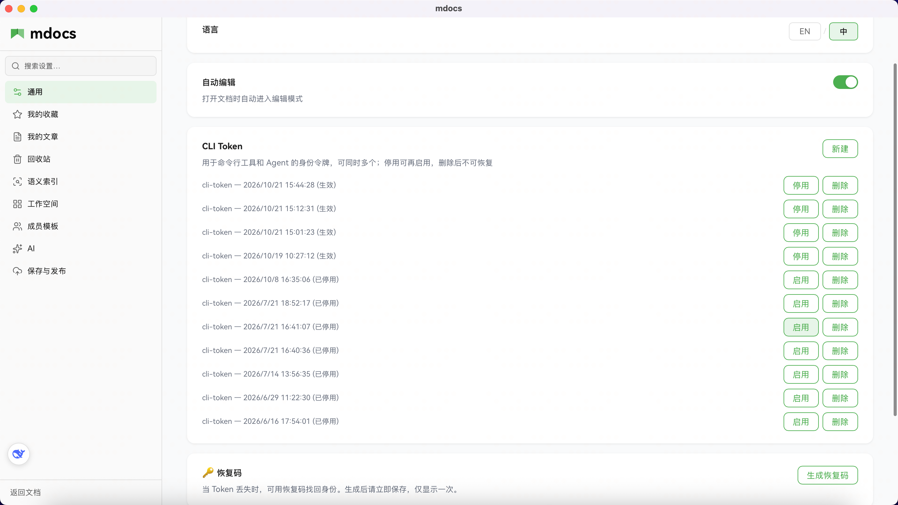

# CLI Token

CLI Token 是给命令行工具和 AI Agent（如 Claude Code、Cursor）使用的身份令牌，继承你在 mdocs 中的所有权限。Token 与你的访客身份绑定，创建后可以通过 HTTP API 读写文档。

整体怎么把 CLI / Skills 嵌进开发流程（含 **丢文章 URL**、**`/mdocs-dev`**），见 [Agent 开发闭环](./agent-dev-loop.md)。

最基础的 Agent 用法：加载 **mdocs-cli** skill 后，直接把 mdocs 文章链接发给 Agent，用自然语言说明要读目录、读正文或搜索即可，不必先手写 CLI。

## 适用场景

- **命令行管理**：在服务器上通过脚本批量创建或更新文档
- **Agent 集成**：让 AI 编程助手直接读写你的知识库
- **CI/CD 流水线**：在自动化流程中同步文档

## 管理 Token（可同时多枚）

1. 打开设置（侧栏底部访客信息）→ **通用**。
2. 找到 **CLI Token** 卡片，点 **新建**。
3. 明文 Token **仅在创建时展示一次**，请立即复制保存。

可同时保留多枚 Token（例如本机 Agent、CI 各用一把）。列表里可 **停用 / 启用**；**删除**为硬删，明文立刻失效且不可恢复。



> Token 是高熵随机字符串（32 字节，base64url 编码），安全强度与 Web 端访客令牌相同。

若某一把泄露：对该条 **删除** 或 **停用** 即可，不必动其它 Token。

## CLI 客户端

mdocs 提供了独立的命令行客户端 `mdocs-cli`（[GitHub 仓库](https://github.com/xuhuafeifei/mdocs-cli)），通过 Token 认证操作文档。

### 安装

```bash
git clone https://github.com/xuhuafeifei/mdocs-cli.git ~/.mdocs-cli
```

入口文件：`~/.mdocs-cli/mdocs.mjs`（需 Node.js 18+）

### 连接与认证

全局选项可放在命令任意位置，**优先级高于环境变量**：

| 来源 | Token | 服务端 |
|------|-------|--------|
| 命令行 | `--token <token>`（必填其一） | `--ip <host[:port]>` 可选 |
| 环境变量 | `MDOCS_TOKEN` | `MDOCS_SERVER` |
| 默认 | — | `http://127.0.0.1:4000` |

```bash
# 连远程服务器（一次性）
node ~/.mdocs-cli/mdocs.mjs --token <token> --ip 101.132.222.88:4000 domains

# 或写入环境变量
export MDOCS_TOKEN="<你的 token>"
export MDOCS_SERVER="http://101.132.222.88:4000"
```

### 命令参考

| 命令                                                                               | 用途                          |
| ---------------------------------------------------------------------------------- | ----------------------------- |
| `search --q <关键词> [--domain <工作空间 ID>] [--topn <数量>]`                            | 全文检索文档                  |
| `get <文档ID>`                                                                     | 读取文档完整内容              |
| `create --name <文件名.md> --content <正文> [--domain <工作空间 ID>] [--parent <目录ID>]` | 创建文档                      |
| `update <文档ID> --content <新正文> [--title <新标题>]`                            | 更新文档内容                  |
| `domains`                                                                          | 列出当前 Token 可访问的所有工作空间 |
| `mkdir --domain <工作空间 ID> --name <目录名> [--parent <目录ID>]`                        | 创建目录                      |
| `ls <documentId>` 或 `ls "关键词" --domain <工作空间 ID>`                                 | 列出目录下子节点              |

### 使用示例

```bash
# 搜索文档
node ~/.mdocs-cli/mdocs.mjs search --q "测试文章"

# 创建文档到指定目录
node ~/.mdocs-cli/mdocs.mjs create \
  --name "笔记.md" \
  --title "我的笔记" \
  --content "# 标题\n\n正文内容" \
  --domain <工作空间 ID> \
  --parent <目录ID>

# 更新文档
node ~/.mdocs-cli/mdocs.mjs update <文档ID> \
  --content "新内容" \
  --title "新标题"
```

> 创建和更新文档时，`--content` 支持 Markdown 格式，后端会自动转换为富文本。

## 使用 Token

在命令行或 Agent 配置中，通过 `x-cli-token` 请求头发送：

```bash
# 使用 curl
curl -H "x-cli-token: <你的 token>" https://your-mdocs-server.com/api/documents

# 环境变量（与 --token 二选一）
export MDOCS_TOKEN="<你的 token>"
export MDOCS_SERVER="http://your-mdocs-server.com:4000"   # 可选，默认本机 4000
```

也可在每条命令上用 `--token` / `--ip` 覆盖，见上文「连接与认证」。

Token 继承你当前访客的所有权限——能读的文档它也能读，能写的文档它也能写。

## 管理 Token

在设置页的 CLI Token 卡片中，你可以同时持有**多枚**命名 Token：

- **新建**：不会踢掉已有 Token
- **停用 / 启用**：软停用后可再打开；停用期间该明文不可用
- **删除**：硬删行，明文永久失效（不可恢复）

## 安全说明

- 服务端只存储 Token 的 SHA-256 哈希值，即使数据库泄露也无法伪造请求
- 原始 Token 仅在创建时展示一次，关闭后无法再次查看
- 如怀疑 Token 泄露，请立即停用或删除该枚 Token
